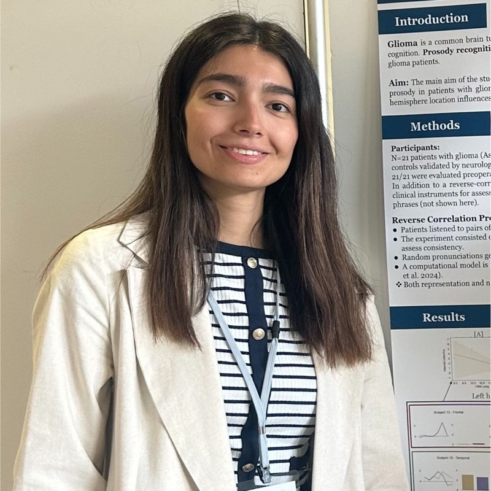

<html lang="en">
<head>
    <meta charset="utf-8">
    <meta name="viewport" content="width=device-width, initial-scale=1">
    <title>Aynaz Adl Zarrabi, PhD | Research & Software</title>

    <link href="https://fonts.googleapis.com/css?family=Source+Sans+Pro:300,300i,400" rel="stylesheet">
    <link href="https://fonts.googleapis.com/css?family=Noticia+Text:400,700" rel="stylesheet">
    <link rel="stylesheet" href="https://cdnjs.cloudflare.com/ajax/libs/font-awesome/4.7.0/css/font-awesome.min.css">
    <link rel="stylesheet" href="https://cdn.rawgit.com/jpswalsh/academicons/master/css/academicons.min.css">
    <link rel="icon" href="./static/images/favicon.svg?20230128H4650">
    <link rel="mask-icon" href="./static/images/favicon.svg" color="#000000">
    <link rel="stylesheet" href="./static/css/style.css?20230128H4650">
</head>

<body>
    

        

        <main class="body">
            

                

                

                    I am a Postdoctoral Researcher in the Gorwood/Ramoz and
                    <a href="https://ipnp.paris5.inserm.fr/recherche/equipes-et-projets/18-equipe-oppenheim" target="_blank" rel="noopener noreferrer">
                        Oppenheim teams at the Institut de Psychiatrie et Neurosciences de Paris (IPNP)
                    </a>.
                    My current research focuses on multimodal neuroimaging and computational modeling to identify structural and functional brain biomarkers associated with anorexia nervosa.
                

                

                    I hold a PhD in
                    <a href="https://theses.fr/s340252" target="_blank" rel="noopener noreferrer">
                        Computer Science and Cognitive Neuroscience
                    </a>
                    from the
                    <a href="https://neuro-team-femto.github.io/" target="_blank" rel="noopener noreferrer">
                        Neuro group at FEMTO-ST
                    </a>
                    (CNRS / Université Marie et Louis Pasteur, France), where I specialized in probabilistic modeling and psychophysics.
                    My doctoral research focused on the latent dynamics of sensory decision-making in post-stroke patients, using data-driven approaches to uncover cognitive and behavioral mechanisms underlying impairments in sensory processing.
                

                

                    I also hold a Master's degree in
                    <a href="https://www.univ-tlse2.fr/accueil/formation-insertion/master-ingenierie-et-science-des-donnees-orientees-metiers-application-a-la-gestion-de-production-ism-ag" target="_blank" rel="noopener noreferrer">
                        Applied Mathematics and Computer Science
                    </a>
                    from Université Toulouse II Jean Jaurès, where I developed expertise in statistical modeling, machine learning, and image processing.
                

                
Click below to view my extended CV:

                <a
                    href="https://raw.githubusercontent.com/aynazadl/aynazadl.github.io/main/CV_AAZ.pdf"
                    target="_blank"
                    rel="noopener noreferrer"
                    download
                    style="display: inline-block; margin-top: 10px; padding: 10px 20px; background-color: #007bff; color: white; font-weight: bold; text-decoration: none; border-radius: 5px;"
                >
                    Download CV (PDF)
                </a>

                <h2>📄 Publications</h2>

                <ul>
                    <li>
                        <b>Adl Zarrabi, A.</b>, Aucouturier, J.-J., &amp; Villain, M.
                        <em>Latent State Modeling of Prosody Perception After Right-Hemisphere Stroke.</em>
                        (In preparation)
                    </li>

                    <li>
                        <b>Adl Zarrabi, A.</b>, Aucouturier, J.-J., Nalborczyk, L., &amp; Villain, M.
                        <em>Three New Analysis Methods to Estimate Internal Noise in Data-Driven Experiments.</em>
                        (In preparation)
                    </li>

                    <li>
                        <b>Adl Zarrabi, A.</b> (2025).
                        <a href="https://theses.hal.science/tel-05372388" target="_blank" rel="noopener noreferrer">
                            Reverse-Correlation Modeling of Deficits of Prosody Perception in Right-Hemisphere Stroke
                        </a>.
                        <em>PhD thesis.</em>
                    </li>

                    <li>
                        <b>Adl Zarrabi, A.</b>, Jeulin, M., Bardet, P., Commère, P., Naccache, L., Aucouturier, J.-J., Ponsot, E., &amp; Villain, M. (2024).
                        <a href="https://www.nature.com/articles/s41598-024-64295-y" target="_blank" rel="noopener noreferrer">
                            A Simple Psychophysical Procedure Separates Representational and Noise Components in Impairments of Speech Prosody Perception After Right-Hemisphere Stroke
                        </a>.
                        <em>Scientific Reports.</em>
                    </li>

                    <li>
                        Merchie, A., Ranty, Z., <b>Adl Zarrabi, A.</b>, Bonnet-Brilhault, F., Houy-Durand, E., Aucouturier, J.-J., &amp; Gomot, M. (2025).
                        <a href="https://doi.org/10.1016/j.reia.2025.202599" target="_blank" rel="noopener noreferrer">
                            Intact Representation of Vocal Smile in Autism: A Reverse-Correlation Approach
                        </a>.
                        <em>Research in Autism.</em>
                    </li>
                </ul>

                

                    More publications and presentations are available on
                    <a href="https://scholar.google.co.uk/citations?hl=en&user=no326G4AAAAJ" target="_blank" rel="noopener noreferrer">
                        Google Scholar
                    </a>.
                

                <h2>🖥️ Software &amp; Open-Source Projects</h2>

                <ul>
                    <li>
                        <b>
                            <a href="https://github.com/aynazadl/palin" target="_blank" rel="noopener noreferrer">
                                PALIN
                            </a>
                        </b>
                        —
                        Python package for estimating internal noise and mental representations through simulation in psychophysical experiments.
                    </li>
                </ul>

                

                    More projects are available on
                    <a href="https://github.com/aynazadl?tab=repositories" target="_blank" rel="noopener noreferrer">
                        GitHub
                    </a>.
                

            

        </main>

        <footer class="footer">
            

                <i>&copy;  Aynaz Adl Zarrabi</i>
            

            

                <ul style="list-style: none; padding: 0;">
                    <li style="display: inline; margin: 0 2px; padding: 0;">
                        <a href="mailto:aynazadl1+www@gmail.com" aria-label="Email">
                            <i class="fa fa-envelope"></i>
                        </a>
                    </li>

                    <li style="display: inline; margin: 0 2px; padding: 0;">
                        <a href="https://github.com/aynazadl" target="_blank" rel="noopener noreferrer" aria-label="GitHub">
                            <i class="fa fa-github"></i>
                        </a>
                    </li>

                    <li style="display: inline; margin: 0 2px; padding: 0;">
                        <a href="https://www.linkedin.com/in/aynaz-adl-zarrabi/" target="_blank" rel="noopener noreferrer" aria-label="LinkedIn">
                            <i class="fa fa-linkedin"></i>
                        </a>
                    </li>

                    <li style="display: inline; margin: 0 2px; padding: 0;">
                        <a href="https://scholar.google.co.uk/citations?hl=en&user=no326G4AAAAJ" target="_blank" rel="noopener noreferrer" aria-label="Google Scholar">
                            <i class="ai ai-google-scholar"></i>
                        </a>
                    </li>
                </ul>
            

        </footer>
    

</body>
</html>
